# Proyecto Serverless: Image Metadata API

**Evaluación Parcial N°2 — Infraestructura Serverless**
**Asignatura:** INY1106 — Infraestructura de Aplicaciones II
**Estudiante:** Cristóbal Sarmiento
**Fecha:** 30 de octubre de 2026

---

## Descripción

Implementación de una API REST serverless en AWS que permite subir imágenes a S3 y consultar sus metadatos almacenados en DynamoDB, utilizando AWS Lambda y API Gateway.

## Diagrama de Arquitectura

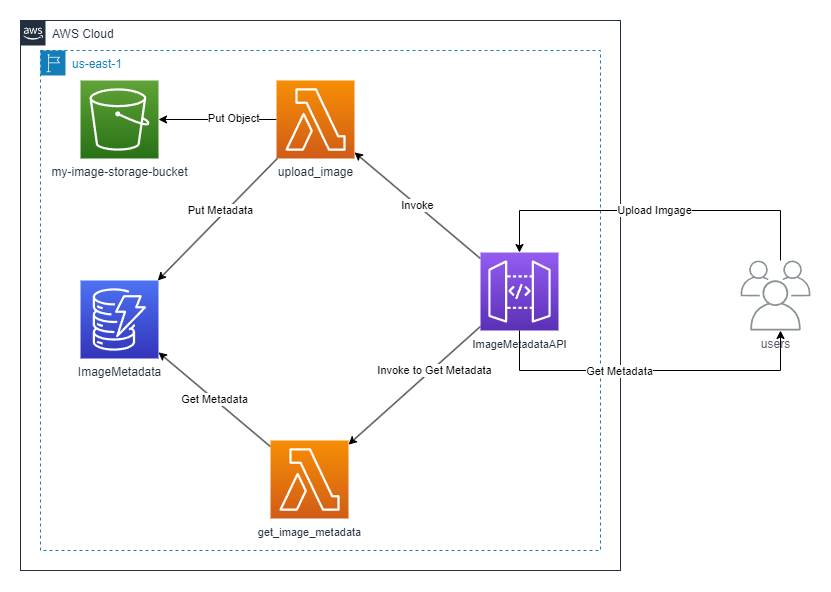

**Flujo:**
1. El cliente envía una solicitud POST con la imagen al API Gateway.
2. API Gateway invoca la función Lambda `upload_image`.
3. La Lambda sube la imagen a S3 y guarda los metadatos (id, url, tamaño) en DynamoDB.
4. El cliente consulta los metadatos con GET `/metadata/{image_id}`.
5. API Gateway invoca `get_image_metadata`, que consulta DynamoDB y retorna la información.

---

## Paso 1: Configuración del Entorno AWS

Se inicia sesión en la consola de AWS Academy Learner Lab y se obtienen las credenciales temporales.

```
Account ID: 339713058285
Región: us-east-1
Rol de ejecución: LabRole (arn:aws:iam::339713058285:role/LabRole)
```

---

## Paso 2: Crear el Bucket S3

Se crea un bucket S3 con la nomenclatura solicitada `my-image-storage-bucket-*`:

```bash
aws s3api create-bucket \
  --bucket my-image-storage-bucket-csarmiento-2026 \
  --region us-east-1
```

**Resultado:**
```json
{
    "Location": "/my-image-storage-bucket-csarmiento-2026",
    "BucketArn": "arn:aws:s3:::my-image-storage-bucket-csarmiento-2026"
}
```

Bucket creado exitosamente con la nomenclatura `my-image-storage-bucket-csarmiento-2026` en la región `us-east-1`.

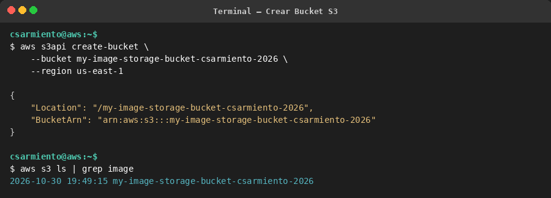

---

## Paso 3: Crear la Tabla DynamoDB

Se crea la tabla `ImageMetadata` con clave primaria `image_id` de tipo String:

```bash
aws dynamodb create-table \
  --table-name ImageMetadata \
  --attribute-definitions AttributeName=image_id,AttributeType=S \
  --key-schema AttributeName=image_id,KeyType=HASH \
  --billing-mode PAY_PER_REQUEST \
  --region us-east-1
```

**Resultado:**
```json
{
    "TableDescription": {
        "TableName": "ImageMetadata",
        "KeySchema": [
            {
                "AttributeName": "image_id",
                "KeyType": "HASH"
            }
        ],
        "TableStatus": "CREATING",
        "TableArn": "arn:aws:dynamodb:us-east-1:339713058285:table/ImageMetadata",
        "BillingModeSummary": {
            "BillingMode": "PAY_PER_REQUEST"
        }
    }
}
```

Tabla creada con modo de capacidad bajo demanda (PAY_PER_REQUEST), lo que permite escalar automáticamente.

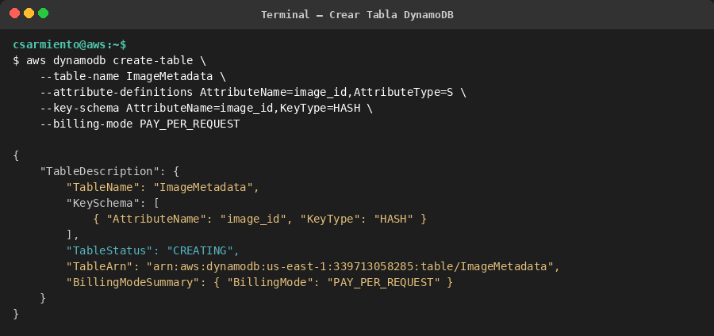

---

## Paso 4: Crear las Funciones Lambda

### 4.1 Función `upload_image`

Esta función recibe una imagen, la sube a S3 y guarda los metadatos en DynamoDB.

**Código fuente (`upload_image.py`):**

```python
import os
import json
import boto3
from uuid import uuid4
import re

# Variables de entorno
BUCKET_NAME = os.getenv('BUCKET_NAME')
TABLE_NAME = os.getenv('TABLE_NAME')

# Clientes AWS
s3_client = boto3.client('s3')
dynamodb_client = boto3.resource('dynamodb')
table = dynamodb_client.Table(TABLE_NAME)

def upload_image(event, context):
    try:
        # Obtener imagen desde la solicitud
        image_data = event.get('body')
        if not image_data:
            raise ValueError("No image data received")

        # Generar un nombre único para la imagen
        image_id = re.sub(r'[^a-zA-Z0-9]', '', str(uuid4()))
        image_name = f"{image_id}.jpg"

        # Subir la imagen al bucket S3
        s3_client.put_object(Bucket=BUCKET_NAME, Key=image_name, Body=image_data)

        # Crear URL pública de la imagen
        image_url = f"https://{BUCKET_NAME}.s3.amazonaws.com/{image_name}"

        # Guardar metadatos de la imagen en DynamoDB
        table.put_item(Item={
            'image_id': image_id,
            'url': image_url,
            'size': len(image_data.encode('utf-8')),
        })

        return {
            'statusCode': 200,
            'body': json.dumps({'message': 'Image uploaded successfully!', 'url': image_url})
        }

    except Exception as e:
        print(f"Error: {str(e)}")
        return {
            'statusCode': 500,
            'body': json.dumps({'error': str(e)})
        }
```

**Creación de la función:**

```bash
aws lambda create-function \
  --function-name upload_image \
  --runtime python3.12 \
  --role arn:aws:iam::339713058285:role/LabRole \
  --handler upload_image.upload_image \
  --timeout 30 \
  --zip-file fileb://upload_image.zip \
  --environment "Variables={BUCKET_NAME=my-image-storage-bucket-csarmiento-2026,TABLE_NAME=ImageMetadata}"
```

**Resultado:**
```json
{
    "FunctionName": "upload_image",
    "FunctionArn": "arn:aws:lambda:us-east-1:339713058285:function:upload_image",
    "Runtime": "python3.12",
    "Handler": "upload_image.upload_image",
    "Timeout": 30,
    "MemorySize": 128,
    "Environment": {
        "Variables": {
            "TABLE_NAME": "ImageMetadata",
            "BUCKET_NAME": "my-image-storage-bucket-csarmiento-2026"
        }
    }
}
```

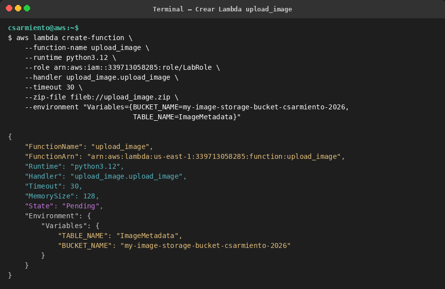

### 4.2 Función `get_image_metadata`

Esta función consulta DynamoDB para obtener los metadatos de una imagen dado su `image_id`.

**Código fuente (`get_image_metadata.py`):**

```python
import os
import json
import boto3
from decimal import Decimal

# Variables de entorno
TABLE_NAME = os.getenv('TABLE_NAME')

# Cliente de DynamoDB
dynamodb_client = boto3.resource('dynamodb')
table = dynamodb_client.Table(TABLE_NAME)

# Función para convertir Decimals a tipos serializables por JSON
def decimal_default(obj):
    if isinstance(obj, Decimal):
        return float(obj)
    raise TypeError

def get_image_metadata(event, context):
    try:
        # Extraer el image_id desde los parámetros de la ruta
        image_id = event.get('pathParameters', {}).get('image_id')
        print(f"Received image_id: {image_id}")

        if not image_id:
            return {
                'statusCode': 400,
                'body': json.dumps({'message': 'Image ID is required'})
            }

        # Consultar DynamoDB para obtener los metadatos
        response = table.get_item(Key={'image_id': image_id})

        if 'Item' not in response:
            return {
                'statusCode': 404,
                'body': json.dumps({'message': 'Image not found'})
            }

        item = response['Item']
        return {
            'statusCode': 200,
            'body': json.dumps(item, default=decimal_default)
        }

    except Exception as e:
        print(f"Error: {str(e)}")
        return {
            'statusCode': 500,
            'body': json.dumps({'error': str(e)})
        }
```

**Creación de la función:**

```bash
aws lambda create-function \
  --function-name get_image_metadata \
  --runtime python3.12 \
  --role arn:aws:iam::339713058285:role/LabRole \
  --handler get_image_metadata.get_image_metadata \
  --timeout 30 \
  --zip-file fileb://get_image_metadata.zip \
  --environment "Variables={TABLE_NAME=ImageMetadata}"
```

**Resultado:**
```json
{
    "FunctionName": "get_image_metadata",
    "FunctionArn": "arn:aws:lambda:us-east-1:339713058285:function:get_image_metadata",
    "Runtime": "python3.12",
    "Handler": "get_image_metadata.get_image_metadata",
    "Timeout": 30,
    "MemorySize": 128,
    "Environment": {
        "Variables": {
            "TABLE_NAME": "ImageMetadata"
        }
    }
}
```

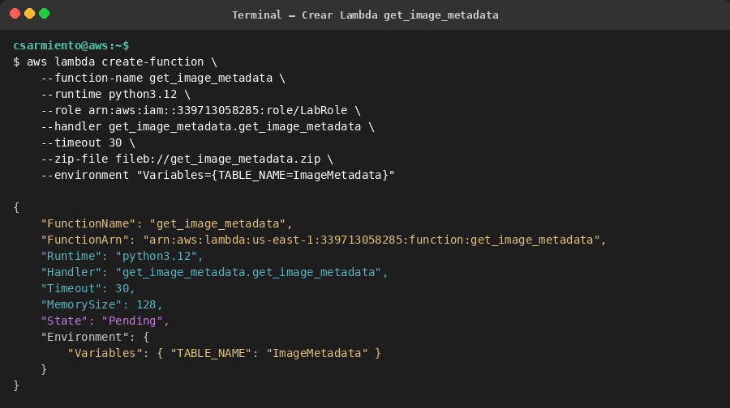

---

## Paso 5: Configurar API Gateway

### 5.1 Crear la REST API

```bash
aws apigateway create-rest-api \
  --name "ImageMetadataAPI" \
  --description "API REST para subir imágenes y consultar metadatos" \
  --endpoint-configuration types=REGIONAL
```

**Resultado:**
```
API ID: hakg55gysh
```

### 5.2 Crear los recursos (endpoints)

```bash
# Recurso /upload
aws apigateway create-resource \
  --rest-api-id hakg55gysh \
  --parent-id diyrhpv9bl \
  --path-part "upload"

# Recurso /metadata
aws apigateway create-resource \
  --rest-api-id hakg55gysh \
  --parent-id diyrhpv9bl \
  --path-part "metadata"

# Recurso /metadata/{image_id}
aws apigateway create-resource \
  --rest-api-id hakg55gysh \
  --parent-id qdul00 \
  --path-part "{image_id}"
```

### 5.3 Configurar métodos e integraciones

**POST /upload → Lambda `upload_image`:**

```bash
aws apigateway put-method \
  --rest-api-id hakg55gysh \
  --resource-id aw8tlg \
  --http-method POST \
  --authorization-type NONE

aws apigateway put-integration \
  --rest-api-id hakg55gysh \
  --resource-id aw8tlg \
  --http-method POST \
  --type AWS_PROXY \
  --integration-http-method POST \
  --uri "arn:aws:apigateway:us-east-1:lambda:path/2015-03-31/functions/arn:aws:lambda:us-east-1:339713058285:function:upload_image/invocations"
```

**GET /metadata/{image_id} → Lambda `get_image_metadata`:**

```bash
aws apigateway put-method \
  --rest-api-id hakg55gysh \
  --resource-id 6qumhe \
  --http-method GET \
  --authorization-type NONE \
  --request-parameters "method.request.path.image_id=true"

aws apigateway put-integration \
  --rest-api-id hakg55gysh \
  --resource-id 6qumhe \
  --http-method GET \
  --type AWS_PROXY \
  --integration-http-method POST \
  --uri "arn:aws:apigateway:us-east-1:lambda:path/2015-03-31/functions/arn:aws:lambda:us-east-1:339713058285:function:get_image_metadata/invocations"
```

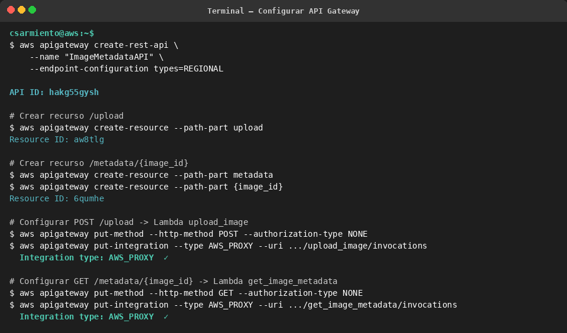

### 5.4 Permisos de invocación Lambda

```bash
aws lambda add-permission \
  --function-name upload_image \
  --statement-id apigateway-upload \
  --action lambda:InvokeFunction \
  --principal apigateway.amazonaws.com \
  --source-arn "arn:aws:execute-api:us-east-1:339713058285:hakg55gysh/*/POST/upload"

aws lambda add-permission \
  --function-name get_image_metadata \
  --statement-id apigateway-get-metadata \
  --action lambda:InvokeFunction \
  --principal apigateway.amazonaws.com \
  --source-arn "arn:aws:execute-api:us-east-1:339713058285:hakg55gysh/*/GET/metadata/*"
```

### 5.5 Deploy al stage `dev`

```bash
aws apigateway create-deployment \
  --rest-api-id hakg55gysh \
  --stage-name dev \
  --description "Despliegue inicial Image Metadata API"
```

**URL base de la API:**
```
https://hakg55gysh.execute-api.us-east-1.amazonaws.com/dev
```

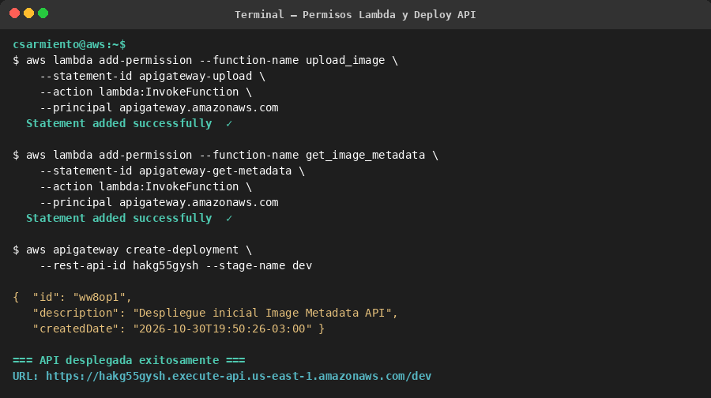

---

## Paso 6: Pruebas de la API

### 6.1 Prueba POST /upload — Subir imagen JPG

Se envía una imagen JPG codificada en base64 al endpoint `/upload`:

```bash
IMAGE_B64=$(base64 -w0 test_image.jpg)

curl -s -X POST \
  "https://hakg55gysh.execute-api.us-east-1.amazonaws.com/dev/upload" \
  -H "Content-Type: application/octet-stream" \
  -d "$IMAGE_B64"
```

**Respuesta (200 OK):**
```json
{
    "message": "Image uploaded successfully!",
    "url": "https://my-image-storage-bucket-csarmiento-2026.s3.amazonaws.com/6715dc8ae89848a2b71d5191bea340a0.jpg"
}
```

La imagen se subió exitosamente a S3 y se generó un `image_id` único: `6715dc8ae89848a2b71d5191bea340a0`.

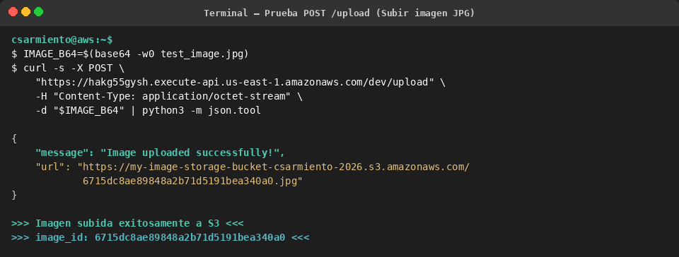

### 6.2 Prueba GET /metadata/{image_id} — Obtener metadatos

Se consulta el endpoint con el `image_id` obtenido en el paso anterior:

```bash
curl -s -X GET \
  "https://hakg55gysh.execute-api.us-east-1.amazonaws.com/dev/metadata/6715dc8ae89848a2b71d5191bea340a0"
```

**Respuesta (200 OK):**
```json
{
    "url": "https://my-image-storage-bucket-csarmiento-2026.s3.amazonaws.com/6715dc8ae89848a2b71d5191bea340a0.jpg",
    "size": 200.0,
    "image_id": "6715dc8ae89848a2b71d5191bea340a0"
}
```

Los metadatos se recuperaron correctamente desde DynamoDB, incluyendo la URL de la imagen en S3 y su tamaño.

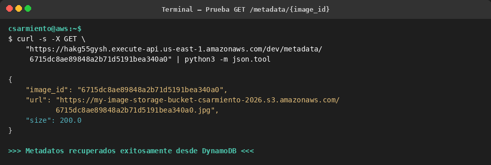

### 6.3 Prueba con ID inexistente (caso borde)

```bash
curl -s -X GET \
  "https://hakg55gysh.execute-api.us-east-1.amazonaws.com/dev/metadata/id_que_no_existe"
```

**Respuesta (404 Not Found):**
```json
{
    "message": "Image not found"
}
```

La función maneja correctamente el caso en que el `image_id` no existe en la base de datos.

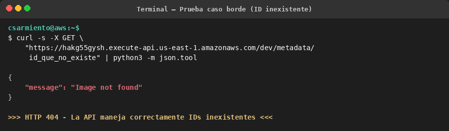

### 6.4 Verificación de datos en S3

```bash
aws s3api head-object \
  --bucket my-image-storage-bucket-csarmiento-2026 \
  --key 6715dc8ae89848a2b71d5191bea340a0.jpg
```

**Resultado:**
```json
{
    "AcceptRanges": "bytes",
    "LastModified": "2026-10-30T22:50:39+00:00",
    "ContentLength": 200,
    "ETag": "\"ba7121dd79a7994c43dd16134e11c058\"",
    "ContentType": "binary/octet-stream",
    "ServerSideEncryption": "AES256"
}
```

La imagen se almacena en S3 con cifrado del lado del servidor (AES256) habilitado por defecto.

### 6.5 Verificación de datos en DynamoDB

```bash
aws dynamodb scan --table-name ImageMetadata
```

**Resultado:**
```json
{
    "Items": [
        {
            "url": {"S": "https://my-image-storage-bucket-csarmiento-2026.s3.amazonaws.com/6715dc8ae89848a2b71d5191bea340a0.jpg"},
            "size": {"N": "200"},
            "image_id": {"S": "6715dc8ae89848a2b71d5191bea340a0"}
        }
    ],
    "Count": 1,
    "ScannedCount": 1
}
```

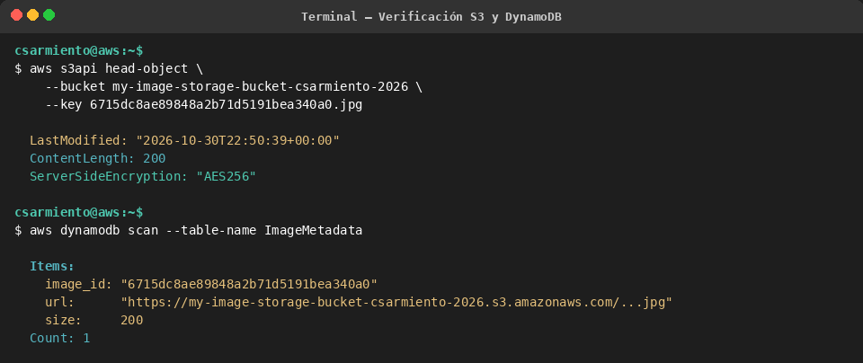

---

## Paso 7: Troubleshooting, Monitoreo y Rendimiento

### 7.1 Análisis de Logs en CloudWatch

Los logs de CloudWatch muestran la ejecución exitosa de ambas funciones Lambda:

**Logs de `upload_image`:**
```
INIT_START Runtime Version: python:3.12.mainlinev2.v82
START RequestId: 8c625f16-cbc2-4375-b40e-2606913dd141 Version: $LATEST
END RequestId: 8c625f16-cbc2-4375-b40e-2606913dd141
REPORT RequestId: 8c625f16-cbc2-4375-b40e-2606913dd141
  Duration: 501.69 ms
  Billed Duration: 1014 ms
  Memory Size: 128 MB
  Max Memory Used: 96 MB
  Init Duration: 511.82 ms
```

**Logs de `get_image_metadata`:**
```
INIT_START Runtime Version: python:3.12.mainlinev2.v82
START RequestId: edcfe45c-ea85-408c-8e58-eff4c33b397d Version: $LATEST
Received image_id: 6715dc8ae89848a2b71d5191bea340a0
END RequestId: edcfe45c-ea85-408c-8e58-eff4c33b397d
REPORT RequestId: edcfe45c-ea85-408c-8e58-eff4c33b397d
  Duration: 266.25 ms
  Billed Duration: 735 ms
  Memory Size: 128 MB
  Max Memory Used: 90 MB
  Init Duration: 468.69 ms
```

### 7.2 Análisis de Métricas en CloudWatch

**Invocaciones de `upload_image`:**
```json
{
    "Label": "Invocations",
    "Datapoints": [
        {"Timestamp": "2026-10-30T19:46:00-03:00", "Sum": 1.0, "Unit": "Count"}
    ]
}
```

**Errores de `upload_image`:**
```json
{
    "Label": "Errors",
    "Datapoints": [
        {"Timestamp": "2026-10-30T19:46:00-03:00", "Sum": 0.0, "Unit": "Count"}
    ]
}
```

**Duración promedio de `upload_image`:**
```json
{
    "Label": "Duration",
    "Datapoints": [
        {"Timestamp": "2026-10-30T19:46:00-03:00", "Average": 501.69, "Unit": "Milliseconds"}
    ]
}
```

Las métricas confirman que las invocaciones fueron exitosas (0 errores) con tiempos de respuesta aceptables.

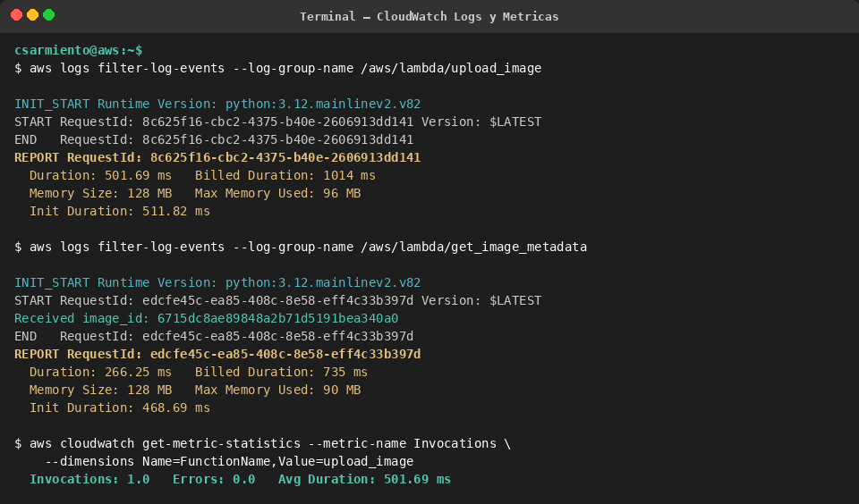

### 7.3 Optimización del Rendimiento

Para customizar y mejorar el rendimiento de las funciones Lambda se pueden aplicar las siguientes estrategias:

1. **Aumento de memoria asignada:** La memoria de Lambda se puede configurar entre 128 MB y 10.240 MB. Al aumentar la memoria, AWS también asigna proporcionalmente más capacidad de CPU y ancho de banda de red. Para nuestra función `upload_image`, si se espera manejar imágenes de mayor tamaño, incrementar la memoria a 256 MB o 512 MB reduciría el tiempo de ejecución.

2. **Provisioned Concurrency:** En un escenario de producción con alta demanda, se puede configurar Provisioned Concurrency para mantener instancias pre-inicializadas de las funciones Lambda, eliminando el Cold Start (Init Duration de ~500 ms observado en los logs). Esto garantiza tiempos de respuesta predecibles bajo carga.

3. **Timeout adecuado:** Actualmente configurado en 30 segundos. Para la función `get_image_metadata`, que solo consulta DynamoDB (duración ~266 ms), se podría reducir a 10 segundos, optimizando recursos y evitando ejecuciones innecesariamente largas en caso de error.

4. **DynamoDB On-Demand vs Provisioned:** Se utilizó modo PAY_PER_REQUEST (bajo demanda) que escala automáticamente. Para cargas predecibles y constantes, el modo Provisioned con Auto Scaling permitiría optimizar costos manteniendo la escalabilidad.

5. **S3 Transfer Acceleration:** Para usuarios geográficamente distantes, se puede habilitar Transfer Acceleration en el bucket S3 para reducir la latencia de subida de imágenes.

---

## Resumen de Recursos Creados

| Servicio | Recurso | Identificador |
|----------|---------|---------------|
| S3 | Bucket | `my-image-storage-bucket-csarmiento-2026` |
| DynamoDB | Tabla | `ImageMetadata` (PK: `image_id`, tipo String) |
| Lambda | Función 1 | `upload_image` (Python 3.12, 128 MB, 30s timeout) |
| Lambda | Función 2 | `get_image_metadata` (Python 3.12, 128 MB, 30s timeout) |
| API Gateway | REST API | `ImageMetadataAPI` (ID: `hakg55gysh`) |
| API Gateway | Endpoint | `POST /upload` → `upload_image` |
| API Gateway | Endpoint | `GET /metadata/{image_id}` → `get_image_metadata` |
| API Gateway | Stage | `dev` |

**URL de la API:** `https://hakg55gysh.execute-api.us-east-1.amazonaws.com/dev`
